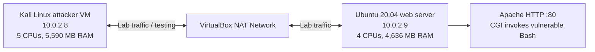
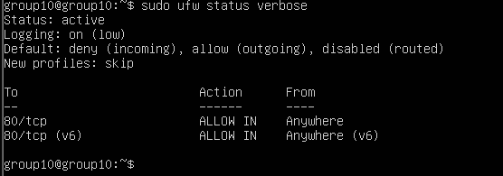
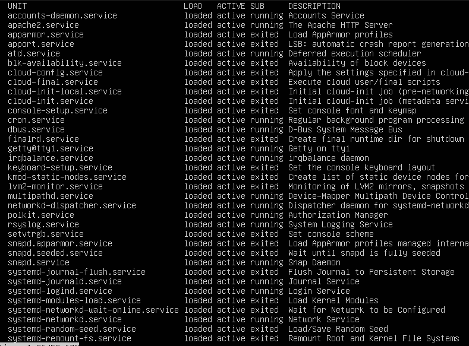

# Shellshock (CVE-2014-6271) - Linux Host Hardening & Penetration Testing Lab

**Controlled university cybersecurity lab | Kali Linux, Ubuntu Server, Apache, UFW and Nmap**

A two-VM security assessment demonstrating the Shellshock vulnerability (CVE-2014-6271) in a deliberately vulnerable Apache CGI/Bash environment, followed by an examination of **Linux host-hardening controls and defensive mitigations**. The project documents reconnaissance, vulnerability validation, low-privilege command execution, a separate privilege-escalation scenario, and system hardening.

> **Scope:** Authorised testing in an isolated VirtualBox lab with deliberately vulnerable software. This is documentation of an educational group project, not a production security assessment or a ready-to-run exploit framework.

## At a glance

| Area | Implementation / evidence |
|---|---|
| Virtual lab | Two VMs on a VirtualBox NAT Network: Kali attacker and Ubuntu 20.04 web server |
| Target | Apache HTTP server with CGI invoking an intentionally vulnerable Bash 4.3 environment |
| Primary vulnerability | Shellshock, **CVE-2014-6271** |
| Investigation tools | Nmap, `http-shellshock` NSE script, curl, Linux system administration tools |
| Attack demonstration | CGI/HTTP-header injection, remote command execution, low-privilege shell |
| Privilege escalation | Deliberately misconfigured SUID binary; a separate PwnKit attempt was unsuccessful |
| Applied hardening | UFW policies, service review, unnecessary package removal, login-shell restrictions, account/password controls, `/etc/shadow` access controls, Apache `PrivateTmp` |
| Additional proposals | Patch vulnerable Bash, remove/rework Bash-backed CGI, WAF, input validation, service isolation and security monitoring |

## Lab architecture

Two Linux virtual machines were configured on the same VirtualBox **NAT Network**:

| Attacker VM | Web-server VM |
|---|---|
|  |  |

[Read the full lab architecture](docs/lab-architecture.md).

## Investigation and attack evidence

### 1. Reconnaissance and service discovery

Network connectivity was established before using Nmap and HTTP inspection to identify the web service available on port 80.

### 2. Shellshock vulnerability validation

The team deployed a test CGI script invoking vulnerable Bash, inspected the handling of HTTP request headers and used Nmap's `http-shellshock` script to verify the vulnerable endpoint.

### 3. Remote command execution

The controlled demonstration showed remote command execution via the vulnerable CGI path and a reverse-shell connection to the attacker VM. Initial shell access was associated with the low-privilege `www-data` web-service account.

### 4. Privilege-escalation scenario

The group attempted PwnKit (CVE-2021-4034), but encountered incompatible library versions between the build and target environments. **That attempted exploit did not provide the demonstrated elevation.** The successful root-level demonstration used a **separately configured, deliberately misconfigured SUID binary**.

The distinction matters: Shellshock provided the initial command-execution path; the separate SUID misconfiguration provided the observed elevation to root.

[Read the evidence-based attack walkthrough](docs/attack-walkthrough.md).

## Linux host hardening

The lab applied a series of defensive measures while also reviewing residual risks.

### UFW firewall and exposed services

- Configured **default deny for incoming connections**, with outgoing traffic allowed.
- Allowed **HTTP on TCP port 80** for the lab's web-server use case.
- Reviewed listening ports and active services; unnecessary remote-access services, including SSH, were disabled for this scenario.

### Host configuration and access controls

- Reviewed installed packages and removed compiler-related packages and an unused FTP package after examining proposed changes.
- Audited local user accounts and changed the `sync` account to disallow an interactive login shell; locked password-based access to root.
- Configured **150-day maximum password age** and **12-character minimum password length**.
- Verified restrictions on reading `/etc/shadow` as an unprivileged user.
- Enabled Apache **`PrivateTmp`** to isolate its temporary-file namespace.

> **Important:** These are defence-in-depth controls. Removing compilers or restricting services does **not** itself patch Shellshock or guarantee prevention of command execution. Updating vulnerable Bash and eliminating exposure through Bash-backed CGI are direct remediation priorities.

### Recommended additional protections (not claimed as deployed)

- Replace or patch vulnerable Bash, and review CGI entry points.
- Use strict server-side request validation and a WAF as supplementary controls.
- Replace Bash-dependent CGI handlers with safer implementations where possible.
- Isolate web services and monitor suspicious request patterns, shell execution and outbound connections.

[Read the implemented controls versus recommendations](docs/hardening-controls.md).

## Key outcomes and lessons

- Demonstrated how a vulnerable CGI/Bash boundary exposes a host to command execution.
- Validated vulnerability indicators through reconnaissance, HTTP inspection and targeted scanning.
- Distinguished initial `www-data` access from later root-level escalation via a separate SUID misconfiguration.
- Applied and documented practical Linux host hardening, including firewall, service and account configuration.
- Identified limitations of general hardening and the importance of addressing the underlying vulnerable component.

## Documentation

- [Project overview and objectives](PROJECT-OVERVIEW.md)
- [Full group report — 18 pages, including references](docs/project-report.pdf)
- [Lab architecture and VM specifications](docs/lab-architecture.md)
- [Hardening controls and mitigation priorities](docs/hardening-controls.md)
- [Attack evidence walkthrough](docs/attack-walkthrough.md)
- [Contributors and attribution](CONTRIBUTORS.md)

## Project contributors

This was a **five-person university group project**. Contributors are acknowledged together; this repository does not attempt to attribute individual tasks without supporting evidence.

**Adam Glasheen · Filip Kapusciak · Stephen McNeill Killeen · Luke O'Sullivan · Sean O'Brien**

See [CONTRIBUTORS.md](CONTRIBUTORS.md) for full acknowledgements.

## Repository scope

The evidence and screenshots here come from the original project report and supplied VM specifications. No VM disks, new scripts, source-code artifacts or configuration files were added; they were not provided for publication. This is a **documentation-based cybersecurity lab portfolio**, not a downloadable configured vulnerable virtual machine.

**Security note:** Do not reproduce this vulnerable configuration on publicly reachable systems. The testing described here was carried out only in a controlled educational environment.
