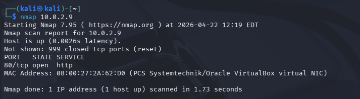
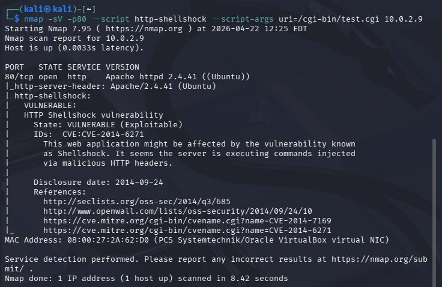
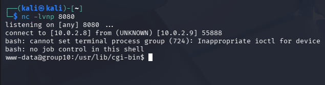
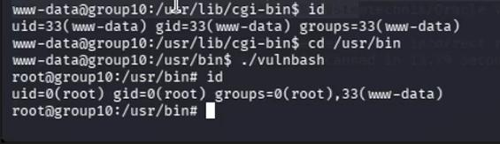
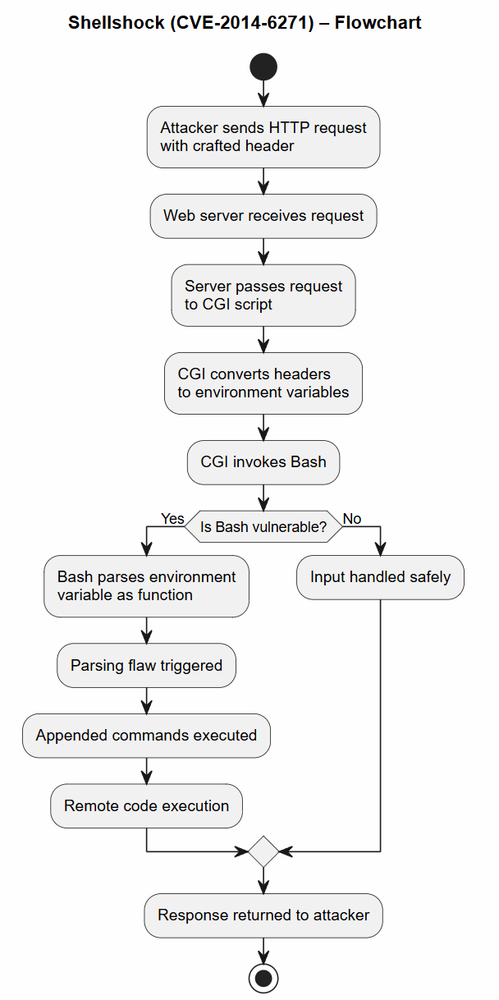

# Investigation and attack walkthrough

This document summarises the sequence **reported by the project team**. All actions occurred against an intentionally vulnerable local VM. It is a technical account of observations, not a guide to attacking real systems.

## Phase 1: Reconnaissance

The group verified basic network connectivity between Kali Linux and the Ubuntu web server. Nmap and HTTP-header inspection identified an Apache service on TCP port 80.

## Phase 2: CGI and Shellshock validation

A lab CGI script was configured to execute through a deliberately vulnerable Bash version. The group inspected the treatment of HTTP headers and used the Nmap `http-shellshock` test to validate the exposed endpoint.

## Phase 3: Initial execution and access

Testing demonstrated command execution triggered through specially constructed HTTP input. A controlled reverse connection was established back to Kali. The first interactive execution context was the restricted Apache user, `www-data`.

## Phase 4: Privilege escalation

An attempted exploitation of PwnKit (CVE-2021-4034) **did not succeed** due to incompatible library versions. The group subsequently demonstrated root-level elevation using a deliberately misconfigured SUID binary set up in the lab. This was a **separate** weakness, not an automatic result of the Shellshock flaw.

## Phase 5: Defence and reflection

The team applied host-hardening configurations including UFW, reduced unnecessary software and services, adjusted local account/password controls, examined sensitive-file access, and enabled Apache `PrivateTmp`. Other mitigations such as WAF protection, safer CGI implementation, input validation and monitoring were discussed as recommendations.

For detailed original screenshots, step-by-step observations and references, see the [project report](project-report.pdf). The PDF does not include the original assessment cover page or student numbers.
