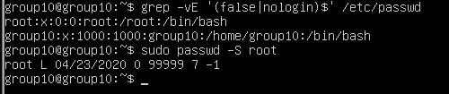

# Host hardening: measures applied versus proposed

This document separates what the group reported **actually configuring or verifying** in the Ubuntu lab from **recommendations** that were discussed but not shown as implemented.

## Applied or verified in the lab

| Control | Reported action and evidence | Practical security role |
|---|---|---|
| UFW | Enabled; inbound denied by default, outbound allowed; TCP/80 opened for HTTP | Reduce unintended inbound exposure |
| Listening ports | Examined `ss -tulnp` output | Identify open services and interfaces |
| Services | Reviewed systemd services; no SSH remote access for this scenario | Reduce attack surface |
| Installed packages | Reviewed `dpkg -l`; simulated removal and removed unnecessary compiler tooling and an FTP package | Reduce unnecessary components |
| User shells | Reviewed `/etc/passwd`; removed login shell capability from `sync` | Limit unnecessary interactive login paths |
| Root account | Locked password-based root account access | Reduce direct password-based root login |
| Password controls | Maximum password age set to 150 days; minimum length to 12 characters | Improve local credential policy |
| Sensitive files | Tested that an unprivileged account could not read `/etc/shadow` | Check access restrictions |
| Apache `PrivateTmp` | Enabled for Apache | Isolate service temporary files |

### UFW policy evidence

### Service review evidence

### Login-shell restriction evidence

## Recommendations described in the project (not evidenced as deployed)

| Recommendation | Rationale |
|---|---|
| **Patch or replace vulnerable Bash** | Directly remove the underlying vulnerable component |
| Replace Bash-backed CGI or use a non-Bash interpreter | Remove the vulnerable interpreter from the web request path |
| Web application firewall | Supplement protection through request filtering; not a replacement for patching |
| Request/header validation | Reduce exposure to malformed or malicious input |
| Application/service isolation | Restrict impact of compromise |
| Detect unusual request patterns or Bash execution | Improve investigation and incident visibility |
| HTTPS for a production web server | Protect traffic in production; the lab intentionally used HTTP on port 80 |
| SSH hardening if needed | Restrict root login, use SSH keys and brute-force defences; SSH was disabled in this lab |

## Hardening does not guarantee immunity

The report documents a controlled scenario in which a deliberately vulnerable CGI/Bash environment remained exploitable. Firewall and general configuration measures alone are insufficient when a necessary exposed service invokes vulnerable code. Removing compilers does not prevent all malicious binaries, script interpreters or command execution. The observed root escalation stemmed from a separate, intentionally misconfigured SUID binary.

The appropriate priority is to **fix the underlying vulnerability**, reduce exposed functionality, use least privilege and monitoring, and validate the configuration over time.
