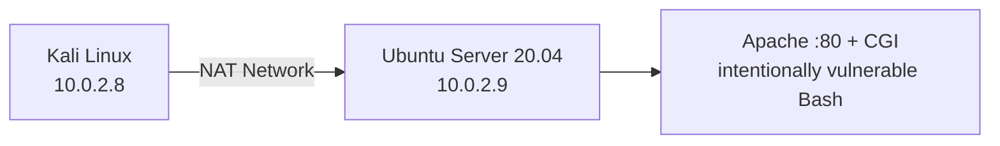
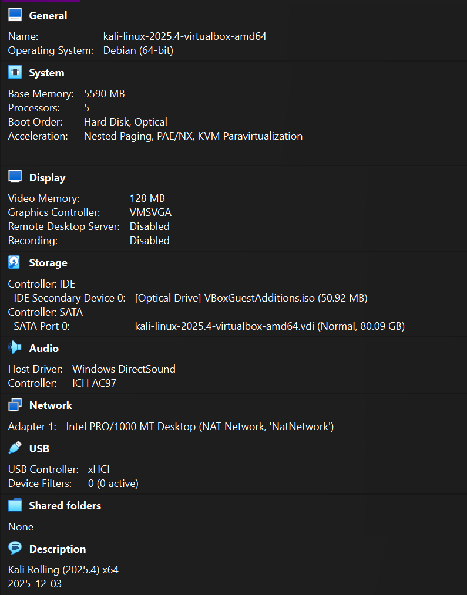
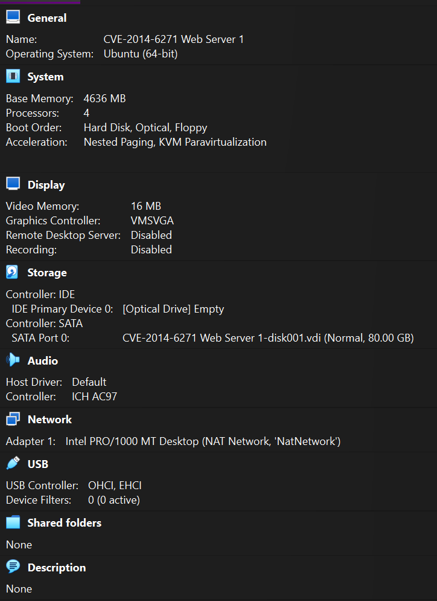

# Lab architecture and VM configuration

## Network topology

The group constructed an isolated **two-VM VirtualBox NAT Network** to allow testing from Kali Linux against a deliberately vulnerable Ubuntu web server.

The IPv4 addresses are private lab addresses, not public hosts.

## Attacker VM

- Role: Kali Linux attacker workstation
- Guest profile in VirtualBox: Debian (64-bit), running Kali Linux 2025.4
- Allocated RAM: **5,590 MB**
- Allocated processors: **5**
- Network adapter: Intel PRO/1000 MT Desktop, **NAT Network (`NatNetwork`)**
- Source: uploaded VirtualBox settings screenshot

## Target VM

- Role: Ubuntu web server (Ubuntu 20.04 in the report)
- VirtualBox guest type: Ubuntu (64-bit)
- Allocated RAM: **4,636 MB**
- Allocated processors: **4**
- Network adapter: Intel PRO/1000 MT Desktop, **NAT Network (`NatNetwork`)**
- Apache on HTTP port 80 with a deliberately vulnerable CGI/Bash configuration
- Source: uploaded VirtualBox settings screenshot and original group report

## Attack surface

The target exposed an Apache web service configured to execute a CGI script through Bash. The lab intentionally introduced a vulnerable Bash version for Shellshock testing and separately configured an insecure SUID binary for the root-level escalation demonstration.

## Scope and operational cautions

The NAT network supported communication within the lab. A NAT configuration should not be treated as a complete isolation or security guarantee; users must avoid exposing deliberately vulnerable software to production or untrusted networks. This repository does not include VM images or instructions for deploying a public vulnerable service.
